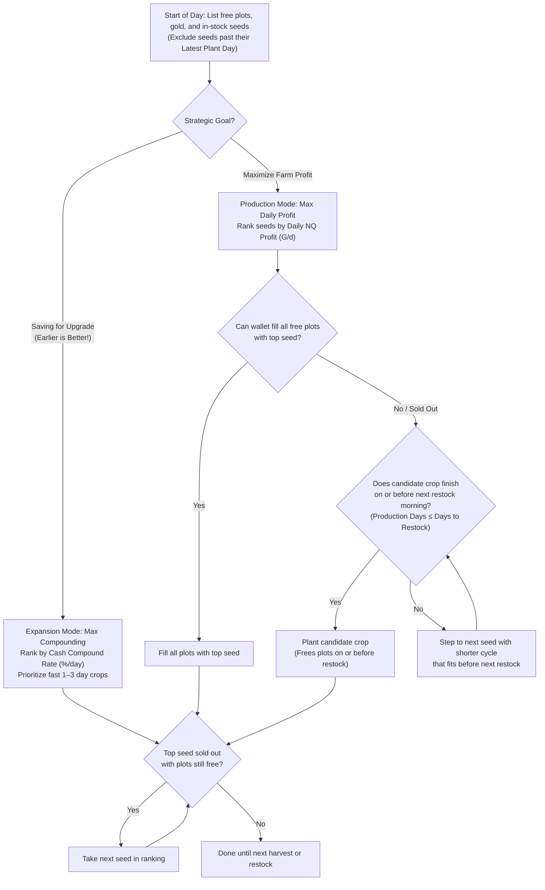

# Harvestella Agricultural Economics & Crop Profit Optimizer

A data-driven toolkit and guide for maximizing farming profits in Square Enix's **Harvestella**.

This repository models realistic agricultural economics in Harvestella, accounting for actual in-game constraints: the **30-day season**, the season-ending **Quietus** disaster, **overnight shipping delays (+1 day payout)**, biome/plot requirements, and initial cash constraints.

---

## Features

- **Comprehensive Crop Master Catalog (`crop_master_catalog.csv`)**:
  - Detailed pricing, growth cycles, repeat harvest intervals, biome/land requirements (Farm, Waterside, Cave), vendor towns, and seasonal availability.
- **Realistic Game Mechanics Modeling**:
  - **Shipping Delay (+1d)**: Shipped crops yield gold the following morning, impacting cash turnaround.
  - **Quietus Deadlines**: Seasons run exactly 30 days. Unharvested annual crops die on Day 30 without payout.
  - **Single vs. Repeat Harvests**: Distinct mathematical models for one-time plantings versus recurring crops (e.g., Nemean Tomato, Morrocorn, Islet Watermelon) and multi-season orchard trees.
- **Core Financial & Scheduling Metrics**:
  - **Daily NQ Profit**: Normal quality daily gold return per farm plot per growth day ($G/\text{day}$).
  - **Cash Compound Rate (%/day)**: Daily exponential growth rate of capital—essential when starting with low gold.
  - **Production Days**: Total active lifecycle days a crop occupies the plot through all harvest cycles.
  - **Latest Plant Day**: The exact cutoff calendar day to plant seeds without forfeiting a harvest cycle before Quietus ($30 - \text{Production Days}$).
- **Automated CLI Tools**:
  - `run_all.py`: Runs the complete pipeline (reorders catalog, splits seasons, computes & saves metrics).
  - `compute_crop_metrics.py`: Computes financial and scheduling rankings across seasons.
  - `split_crops_by_season.py`: Generates clean, per-season CSV data subsets from the master catalog.
  - `reorder_crop_catalog.py`: Reorders the master catalog by vendor town and crop name.

---

## Repository Structure

```text
Harvestella/
├── crop_master_catalog.csv    # Master catalog of all crops, costs, cycles, and biomes
├── crop_metrics_guide.md      # Mathematical derivation and formula guide for metrics
├── run_all.py                 # Master pipeline runner (reorder -> split -> compute)
├── compute_crop_metrics.py    # CLI tool to calculate profit, compound rates, and deadlines
├── split_crops_by_season.py   # Utility to regenerate seasonal CSV files from master catalog
├── reorder_crop_catalog.py    # Utility to sort master catalog by vendor town and crop name
├── seasons/                   # Per-season CSV data
│   ├── spring.csv
│   ├── summer.csv
│   ├── fall.csv
│   └── winter.csv
└── archive/                   # Reference analysis tables and legacy farming guides
```

---

## Quick Start

### Prerequisites
- Python 3.10+ (uses standard library only—no external pip packages required).

### 1. Run Complete Pipeline (One-Click)

To reorder the catalog, regenerate seasonal CSVs, and compute/save all metrics in one command:
```bash
python run_all.py
```

### 2. Compute Crop Economics & Schedules

To analyze a specific season (e.g., Spring):
```bash
python compute_crop_metrics.py -i spring
```

To analyze all seasons simultaneously:
```bash
python compute_crop_metrics.py --all
# or using shorthand:
python compute_crop_metrics.py -a
```

To compute metrics and write the calculated columns directly into the CSV files in `seasons/`:
```bash
python compute_crop_metrics.py -a -s
# or combined:
python compute_crop_metrics.py -as
```

To output the analysis to a custom file:
```bash
python compute_crop_metrics.py -i summer -o summer_analyzed.csv
```

To sort by **Cash Compound Rate** instead of the default **Daily NQ Profit**:
```bash
python compute_crop_metrics.py -i spring --sort compound
```

### 2. Regenerate Seasonal CSVs

If you update `crop_master_catalog.csv`, regenerate the seasonal tables using:
```bash
python split_crops_by_season.py
```

Include all-year crops across every seasonal file:
```bash
python split_crops_by_season.py --include-all-year
```

---

## Core Financial Metrics

For full mathematical definitions, derivations, and formulas, see [crop_metrics_guide.md](file:///c:/Users/leona/GitHub/Harvestella/crop_metrics_guide.md).

| Metric | Formula / Concept | When to Prioritize |
| :--- | :--- | :--- |
| **Cash Compound Rate (%/day)** | $r = \left(\left(\frac{\text{Sell}}{\text{Seed}}\right)^{\frac{1}{\text{Days} + 1}} - 1\right) \times 100\%$ | **Early Game / Low Gold:** Maximize the speed at which your initial wallet multiplies. |
| **Daily NQ Profit** | $\delta = \frac{\text{Net Profit}}{\text{Production Days}}$ | **Cycle Efficiency & Plot Profit:** Compares normal quality profit generation velocity per plot across crops of different harvest lengths. |
| **Production Days** | Single: $m\text{ days}$ <br> Repeat: $m + (n - 1) \cdot g\text{ days}$ | **Turnaround Planning:** Total calendar time the crop occupies the soil before the plot is freed up. |
| **Latest Plant Day** | $30 - \text{Production Days}$ | **Quietus Management:** Cutoff day to plant without withering at Quietus or losing harvest cycles. |

---

## Strategy Cheat-Sheet

**Goal: maximize the wallet by the end of the 30-day season.** Every season ends at Quietus, which wipes out unharvested annual crops.

### Planning Assumptions

- **Seed stock is capped, and the shop restocks every 10 days** (Day 1, Day 11, Day 21). Each restock is a fixed pool of seeds, so you cannot keep replanting one cheap crop forever.
- **Plot upgrades are expensive and come in large batches** (many plots at once, up to an eventual cap). Leftover gold from daily buying will almost never cover one, so an upgrade has to be **saved for on purpose**.
- **Plant-time is the real currency.** A seed occupies a plot for its **Production Days**, and a plot supplies 10 plot-days per restock window.

### Which Metric Wins? It Depends on Your Strategic Mode

Three constraints limit any seed purchase: **wallet gold**, **free plots**, and **vendor seed stock**. Your ranking depends on your strategic objective:

| Mode | Trigger / Goal | Metric to Rank By | Why It Wins |
| :--- | :--- | :--- | :--- |
| **Expansion Mode** | **Saving for a Farm Upgrade** *(Earlier is better!)* | **Cash Compound Rate (%/day)** *(Short 1–3d turnarounds)* | Multiplies wallet gold exponentially and keeps cash liquid, unlocking higher farm tiers days earlier. |
| **Production Mode** | **Maximize Daily Farm Profit** on current plots | **Daily NQ Profit (G/d)** *(Cascading by budget)* | Maximizes total gold generated across your farm. If an expensive top seed (e.g., 2,500 G Watermelon) would leave most plots empty, cascade to high-yield seeds that fully utilize your capacity (e.g., 200 G Morrocorn). |

### Decision Tree (Run at Each Restock, and Whenever a Plot Frees Up)



**Notes on the tree:**

- **Why Expansion Mode Prioritizes Speed**: Upgrading earlier is always better than upgrading later. If you plant slow, high-profit crops (e.g., 6–12 days) while saving, your cash remains frozen in the dirt, delaying your upgrade by days. Fast 1–3 day crops return to your wallet with compounding interest every 48–72 hours, letting you buy the expansion at the earliest possible calendar moment.
- **Budget Cascading in Production Mode (The Watermelon vs. Morrocorn Trap)**:
  - If you have 70 free plots and 10,000 G in Summer, buying 4 Islet Watermelons (@ 2,500 G) spends all 10,000 G but leaves **66 plots empty**, generating only **700 G/d**.
  - Jumping straight to pure cheap compounders (Dress Lettuce @ 55 G) fills all 70 plots for 3,850 G, but generates only **1,050 G/d** while leaving **6,150 G idle**.
  - **The Solution**: Cascade down the Daily Profit ranking to **Morrocorn** (@ 200 G seed). Buying 50 Morrocorn fills 50 plots and generates **2,500 G/d** ($>3.5\times$ Watermelon and $>2\times$ Lettuce).
- **Restock Horizon Alignment ($\text{Production Days} \le \text{Days to Restock}$)**:
  - Vendors restock inventory every 10 days on **Day 1, Day 11, and Day 21** ($R \in \{11, 21, 31\}$).
  - If your top seed is sold out or unaffordable, **never plant a slow crop that overhangs the restock day**.
  - **Example on Day 16** ($R = 21$, remaining window $= 5$ days):
    - Planting **Nemean Tomato** (10 days) locks plots until Day 26, completely missing the Day 21 restock.
    - Instead, pick crops where $\text{Production Days} \le 5$ (e.g., **Morrocorn** 4d, **Dress Lettuce** 2d, or **Carrop** 1d). They finish before Day 21 morning, keeping your plots open and your wallet flush to purchase the restocked seeds.
- **Re-check constraints every time a plot frees up**: A 2-day crop frees its plot every 2 days, while a 12-day crop locks it for 12.
- **Never replace a growing crop**: The seed is a sunk cost; re-ranking only applies to newly empty plots.

### Plot Upgrade Plan (Separate From the Daily Loop)

Farm expansions are permanent (they carry over into all future seasons and years) but come in large, expensive batches from the Renovator in Lethe. Leftover daily cash will not cover them—they must be saved for deliberately.

#### Farm Upgrade Costs & Payback Benchmarks

$$\text{Payback Days} = \frac{\text{Upgrade Cost } (C)}{\text{Tiles Added } (k) \times \text{Daily NQ Profit } (g^*)}$$

| Farm Level | Upgrade Cost | Plot Increment ($k$) | Total Tiles | Cost / Tile | Payback @ 20 G/d (Early) | Payback @ 45 G/d (Mid-Game) | Strategic Assessment |
| :---: | :---: | :---: | :---: | :---: | :---: | :---: | :--- |
| **Level 1** | Free | Starting (10×7) | **70 tiles** | — | — | — | Starting plot. Wallet-limited early on. |
| **Level 2** | **3,000 G** | **+56 tiles** (8×7) | **126 tiles** | **53.6 G** | **2.7 days** | **1.2 days** | **Highest ROI in the game.** Rush this immediately in Spring/Summer. |
| **Level 3** | **8,000 G** | **+21 tiles** (3×7) | **147 tiles** | 381.0 G | 19.0 days | 8.5 days | Stepping stone needed to reach Level 4. |
| **Level 4** | **15,000 G** | **+70 tiles** (10×7) | **217 tiles** | **214.3 G** | **10.7 days** | **4.8 days** | **Huge expansion leap.** Pays back in under 1 week of good crops. |
| **Level 5** | **25,000 G** | **+56 tiles** (8×7) | **273 tiles** | 446.4 G | 22.3 days | 9.9 days | Solid mid-game goal. *Requires Sprinklers to manage stamina.* |
| **Level 6** | **40,000 G** | **+21 tiles** (3×7) | **294 tiles** | 1,904.8 G | 95.2 days | 42.3 days | Expensive bridge tier to Level 7. |
| **Level 7** | **80,000 G** | **+70 tiles** (10×7) | **364 tiles** | 1,142.9 G | 57.1 days | 25.4 days | Late-game industrial farming. |
| **Level 8** | **120,000 G** | **+56 tiles** (8×7) | **420 tiles** | 2,142.9 G | 107.1 days | 47.6 days | End-game orchard / passive empire. |
| **Level 9 (Max)** | **200,000 G** | **+21 tiles** (3×7) | **441 tiles** | 9,523.8 G | 476.2 days | 211.6 days | Pure completionist flex tier. |

> [!TIP]
> **Stamina & Automation Warning**: Do not expand beyond Level 2 (126 tiles) without crafting **Sprinklers** (Level 1 / Level 2). Manually tilling and watering 200+ tiles will deplete your entire stamina bar before noon!

#### How to Execute the Upgrade Saving Plan
1. **Target the High-ROI Tiers Early**: Prioritize **Level 2 (3,000 G)** and **Level 4 (15,000 G)** as soon as possible. Because expansions are permanent, their payback periods are trivial (under a week).
2. **Switch to Expansion Mode**: When saving for an upgrade, **never plant slow crops** (e.g. 6–12+ days). Slow crops freeze your cash in the soil, delaying the day you can purchase the upgrade.
3. **Compound with Short-Cycle Seeds**: Fill your free plots with 1–3 day high-compound crops (e.g., Dress Lettuce, Unionion, Carrop). Your money returns with compounding interest every 48–72 hours.
4. **Trigger the Upgrade Instantly**: The exact morning your wallet crosses the upgrade threshold, buy the expansion. Your plot capacity jumps by $+56$ or $+70$ tiles, and you can immediately transition to Production Mode to maximize daily profits on your expanded farm.

### The 30-Day Flow in Restock Windows

Every season in Harvestella lasts exactly 30 days, ending with the Quietus reset on Day 31. Because general store seed stocks refresh every 10 days (Days 1, 11, and 21), planning your farm around these **three 10-day Restock Windows** prevents wasted gold and crops dying to Quietus:

1. **Window 1 (Days 1–10: Long-Cycle & Repeat Harvest Window)**:
   - **Time Remaining**: 20–30 calendar days left.
   - **Strategic Focus**: This is the **only window** where long multi-harvest repeat crops (e.g., Cucumble, Shatollan Paprika, Revol Pepper) can reach full lifecycle yields. Alternatively, if capital is limited or you are rushing farm expansions (Level 2 or Level 4), sprint 1–3 day compounding crops (Unionion, Dress Lettuce, Carrop) to rapidly compound your wallet.
2. **Window 2 (Days 11–20: Mid-Cycle Cash Crop Window)**:
   - **Time Remaining**: 10–19 calendar days left.
   - **Strategic Focus**: Multi-harvest crops are now locked out by their Quietus deadlines ($30 - \text{Production Days}$). Replant empty plots with high-margin **medium-cycle crops (4–11 days)** like Royal Eggplant, Seatide Garlic, Sudor Pepper, Morrocorn, Nectarcane, or Chilly Plant.
3. **Window 3 (Days 21–30: Short-Cycle Sprint Window)**:
   - **Time Remaining**: 1–9 calendar days left.
   - **Strategic Focus**: Strict Quietus shutdown. All slow-growing crops will die unharvested. Switch all plots to fast 1–4 day sprints (Dress Lettuce, Unionion, Lumpotato, Argene Cabbage, Stellar Wheat, Carrop) to liquidate all plot capacity into cash before Quietus strikes.

---

### Season-by-Season Playbook

| Season | Window 1 (Days 1–10)<br>*Long Multi-Harvest / Repeat* | Window 2 (Days 11–20)<br>*Medium Cash Crops (4–11d)* | Window 3 (Days 21–30)<br>*Short Sprints (1–4d)* | Critical Deadlines & Traps |
| :--- | :--- | :--- | :--- | :--- |
| **Spring** | **Cucumble** (+43.7 G/d, 19d)<br>**Revol Pepper** (+47.8 G/d, 16d)<br>**Strawbuddy** (+35.8 G/d, 12d)<br>*(Or sprint Unionion for Level 2 Farm)* | **Nectarcane** (+38.0 G/d, 10d)<br>**Sudor Pepper** (+38.9 G/d, 9d)<br>**Tingle Radish** (+35.0 G/d, 4d)<br>**Unionion** (+30.0 G/d, 3d) | **Unionion** (+30.0 G/d, 3d)<br>**Dress Lettuce** (+15.0 G/d, 2d)<br>**Stellar Wheat** (+7.5 G/d, 2d)<br>**Carrop** (+20.0 G/d, 1d) | • **Cucumble** cutoff is **Day 11** (19d).<br>• **Revol Pepper** cutoff is **Day 14** (16d).<br>• **Strawbuddy** cutoff is **Day 18** (12d).<br>• Plant **Unionion** up to **Day 27**, **Dress Lettuce** up to **Day 28**. |
| **Summer** | **Shatollan Paprika** (+35.2 G/d, 21d)<br>**Revol Pepper** (+47.8 G/d, 16d)<br>**Islet Watermelon** (+175.0 G/d, 12d)<br>**Morrocorn** (+50.0 G/d, 4d) | **Islet Watermelon** (plant by Day 18)<br>**Seatide Garlic** (+58.3 G/d, 6d)<br>**Morrocorn** (+50.0 G/d, 4d)<br>**Honey Flower** (+41.7 G/d, 6d)<br>**Sudor Pepper** (+38.9 G/d, 9d) | **Morrocorn** (plant by Day 26)<br>**Eden Rice** (+5.0 G/d, 3d)<br>**Dress Lettuce** (+15.0 G/d, 2d)<br>**Stellar Wheat** (+7.5 G/d, 2d)<br>**Carrop** (+20.0 G/d, 1d) | • **Shatollan Paprika** cutoff is **Day 9** (21d).<br>• **Islet Watermelon** cutoff is **Day 18** (12d, 2,500 G seed).<br>• **Morrocorn** is the king of mid/late summer (4d turn, massive compounding + G/d). |
| **Fall** | **Revol Pepper** (+47.8 G/d, 16d)<br>**Royal Eggplant** (+60.0 G/d, 11d)<br>**Lantern Pumpkin** (11d, by Day 19)<br>**Nectarcane** (+38.0 G/d, 10d) | **Royal Eggplant** (plant by Day 19)<br>**Nectarcane** (+38.0 G/d, 10d)<br>**Sudor Pepper** (+38.9 G/d, 9d)<br>**Curry Herbs** (+18.3 G/d, 6d)<br>**Unionion** (+30.0 G/d, 3d) | **Unionion** (+30.0 G/d, 3d)<br>**Lumpotato** (+13.3 G/d, 3d)<br>**Eden Rice** (+5.0 G/d, 3d)<br>**Dress Lettuce** (+15.0 G/d, 2d)<br>**Carrop** (+20.0 G/d, 1d) | • **Revol Pepper** cutoff is **Day 14** (16d).<br>• **Royal Eggplant** cutoff is **Day 19** (11d).<br>• **Sudor Pepper** cutoff is **Day 21** (9d).<br>• **Lumpotato** and **Unionion** plantable up to **Day 27**. |
| **Winter** | **Chilly Plant** (+71.4 G/d, 7d)<br>**Argene Cabbage** (+25.0 G/d, 4d)<br>**Lumpotato** (+13.3 G/d, 3d) | **Chilly Plant** (plant by Day 23)<br>**Argene Cabbage** (+25.0 G/d, 4d)<br>**Lumpotato** (+13.3 G/d, 3d)<br>**Curry Herbs** (plant by Day 24) | **Argene Cabbage** (plant by Day 26)<br>**Lumpotato** (plant by Day 27) | • Restricted seed catalog in Argene.<br>• **Chilly Plant** cutoff is **Day 23** (7d, huge 71.4 G/d return).<br>• **Argene Cabbage** cutoff is **Day 26**.<br>• **Lumpotato** cutoff is **Day 27**. |

---

## License

This project is licensed under the MIT License - feel free to use, modify, and distribute.
