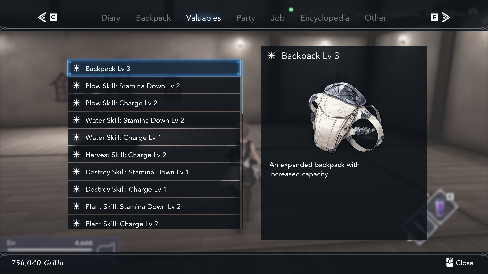

# Harvestella Agricultural Economics & Crop Profit Optimizer

A data-driven toolkit and Mixed-Integer Linear Programming (MILP) optimizer for maximizing farming profits in Square Enix's Harvestella.

> ⚡ **Quick Navigation**: [In-Game Proof (756k G + Lv 6 Farm in Month 2)](#bottom-line-up-front-756040-grilla--level-6-farm-91000-grilla-by-end-of-month-2-summer-year-1) • [The Big Picture](#the-big-picture-why-crop-allocation-is-hard) • [Quick Start & Solver](#quick-start--workflow) • [Farm Expansion Benchmarks](#renovator-plot-expansion-benchmarks-levels-19) • [Data Pipeline](#1-click-data-preparation-pipeline) • [Project Architecture](#project-architecture--documentation)

---

## Bottom Line Up Front: 756,040 Grilla + Level 6 Farm (91,000 Grilla) by End of Month 2 (Summer, Year 1)

By using Mixed-Integer Linear Programming (MILP) schedule to plan daily seed purchases and crop rotations, we achieved **756,040 Grilla** in liquid cash by **Quietus at the end of Summer, Year 1 (end of Month 2)** — on top of already paying for **Level 6 Farm expansions (`91,000 G` cumulative Renovator cost, 294 farm tiles)**, **Backpack Lv 3**, and a **Max-Level Totokaku Mount**:

| **1. 756,040 Grilla Liquid Cash** | **2. Timestamp: End of Summer, Year 1 (Month 2 Quietus)** |
| :---: | :---: |
|  |  |
| ***756,040 Grilla** in liquid cash alongside **Backpack Lv 3**.* | *Save log confirming progression right after `Summer Breeze 29th, year 1` (`Quietus 1st Saturday, year 1`).* |
| **3. Level 6 Farm (294 Tiles) on Summer Day 30** | **4. Max-Level Totokaku Mount on Summer Day 30** |
|  |  |
| *Full-scale **Level 6 Farm (`91,000 G` cumulative upgrade cost)** on `Summer Breeze 30th Friday`.* | *Fully upgraded **Max-Level Totokaku** swimming on `Summer Breeze 30th Friday`.* |

---

## The Big Picture: Why Crop Allocation is Hard

In *Harvestella*, deciding what seeds to buy is not a simple matter of looking up a "best crop" tier list. A player faces four rigid, simultaneous in-game bottlenecks that interact non-linearly:

### The 4 In-Game Bottlenecks

1. **Capital Budget Limit (`wallet_gold`)**: You can only spend the liquid cash currently in your pocket.
2. **Biome Soil Partitioning (`free_plots`)**: Farm land is strictly partitioned into three incompatible soil types:
   - Farm Plots: Standard soil.
   - Waterside Plots: Specialized water soil (e.g., Islet Watermelon, Nectarcane).
   - Cave Plots: Specialized cave soil (e.g., Revol Pepper, Sudor Pepper).
   - *Plots of one biome cannot grow crops from another.*
3. **Vendor Shop Inventory Caps & Town Story Unlocks**: General stores carry a finite stock per 10-day cycle (`seed_stock`, default 99). Furthermore, seeds from Nemea, Shatolla, Argene, or Abandoned Eden are unavailable until those towns are unlocked in the story.
4. **Planning Deadlines (Quietus vs. Restocks)**:
   - Quietus (Day 30): Every season lasts exactly 30 days and terminates with Quietus. All annual crops die on Day 30 without payout.
   - Vendor Restocks (Days 1, 11, 21): Shops refresh stock every 10 days. Slow crops that overhang a restock day lock up your plot capacity and freeze your capital.

---

### How Players Usually Plant (And Why Intuition Fails)

Without an optimizer, managing a farm across a 30-day season breaks down on two fronts: **daily operational friction** and **suboptimal buying heuristics**.

#### 1. The Daily Mental Overhead & Vendor Runaround
In a typical play session, simply figuring out what to buy becomes an exhausting chore:
- **Counting & Memorizing Plots**: Every morning, you harvest ready crops and manually count open tiles across three separate biomes (`Farm`, `Waterside`, `Cave`) around partially grown repeat crops and fruit trees—then try to keep those numbers in your head through dungeons and story missions.
- **The Shop Stock Surprise**: When you finally visit a general store at the end of an adventure day, you often discover the vendor doesn't have enough seeds left in stock (or the crop's growth time will miss the Day 30 Quietus deadline).
- **The Back-and-Forth Loop**: You end up bouncing between your farm, multiple town vendors (Lethe, Nemea, Shatolla, Argene), and a community spreadsheet—frantically cross-checking open plots, remaining store stock, growth days, and wallet cash on the fly.

#### 2. The Single-Seed Traps at the Shop Counter
Even when you stand at a vendor with a spreadsheet open, you cannot mentally solve a multi-variable allocation problem on the spot. Players naturally fall back on trying to buy a single go-to crop—and as shown in a **Summer benchmark** (`8,000 G` budget, `70` Farm plots, with `20` Morrocorn remaining in shop stock), every single-crop playbook hits a wall:

- **Playbook A: All-In on the Highest-Profit Crop (The Capital Starvation Trap)**
  - *Player Intuition (Chasing Land Efficiency — `Daily NQ Profit`, G/d)*: Sort the spreadsheet by raw daily profit per plot, pick the #1 crop (**Seatide Garlic** at `+58.3 G/d`), and spend all your gold on it.
  - *Why It Fails*: At `650 G` per seed, an `8,000 G` budget buys only `12` seeds (spending `7,800 G`). You maximize profit *per seed*, but **58 of your 70 farm plots sit completely empty**, earning only **+700.0 G/d**.

- **Playbook B: Spamming Cheap, Fast Crops (The Land Bottleneck Trap)**
  - *Player Intuition (Chasing Capital Velocity — `Cash Compound Rate`, %/day)*: Realizing expensive seeds drain the wallet too fast, pivot to cheap, fast-turnaround seeds (**Dress Lettuce** at `55 G`, `+15.62%/d` compound rate) so every single plot is planted.
  - *Why It Fails*: Filling all `70` plots costs only `70 × 55 G = 3,850 G`. Your farm is 100% full, but **4,150 G sits idle in your wallet** earning `0%` return. Total daily profit stalls at **+1,050.0 G/d**.

- **Playbook C: Buying Out a Mid-Cost Crop (The Vendor Stock Cap Trap)**
  - *Player Intuition*: Pick a balanced crop with strong daily profit and compound rate (**Morrocorn** at `200 G`, `+50.0 G/d`, `+14.87%/d`) and buy out the store.
  - *Why It Fails*: The vendor only has `20` Morrocorn seeds left in stock (spending `4,000 G`). Once the shop sells out, **50 farm plots and 4,000 G sit completely idle**, capping daily profit at **+1,000.0 G/d**.

---

### The Solution: How Linear Optimization (MILP) Solves Both

Instead of memorizing plot counts across dungeons or guessing between single-crop extremes, this project formulates crop allocation as a **Mixed-Integer Linear Programming (MILP)** model. It takes your exact farm state (`configs/<season>.yaml`) and outputs a complete, vendor-by-vendor daily shopping list before you ever leave your farm.

Economically, it finds the exact **inflection point** across Land Efficiency (`G/d`), Capital Compounding (`%/day`), and Vendor Stock Caps:
1. **Plot-Filling**: Uses cheap, high-compounding crops (like Dress Lettuce) to ensure no farm tile sits idle.
2. **Marginal Upgrading**: Systematically upgrades individual plots to higher-margin crops (like Morrocorn and Seatide Garlic) across all available vendors until both land and gold are fully utilized.

> [!IMPORTANT]
> ### 🌾 The Power of Balanced Allocation (Summer 8,000 G Benchmark)
> 
> Look at what happens to your plots and cash across single-crop strategies versus the MILP blend on the same 70 Farm plots (`8,000 G` budget, `20` Morrocorn in store stock):
> 
> | Strategy | Daily NQ Profit | Compound Rate | Farm Plots Occupied | Gold Capital Spent | Total Daily Profit | What Went Wrong? |
> | :--- | :---: | :---: | :---: | :---: | :---: | :--- |
> | Pure Garlic | +58.3 G/d | +6.35%/d | 12 / 70 (17.1%) | 7,800 G / 8,000 G | +700.0 G/d | Capital Starvation: 650 G seeds deplete cash; 58 plots sit empty! |
> | Pure Morrocorn | +50.0 G/d | +14.87%/d | 20 / 70 (28.6%) | 4,000 G / 8,000 G | +1,000.0 G/d | Vendor Stock Cap: Store runs out at 20 seeds; 50 plots & 4,000 G sit idle! |
> | Pure Lettuce | +15.0 G/d | +15.62%/d | 70 / 70 (100%) | 3,850 G / 8,000 G | +1,050.0 G/d | Land Bottleneck: Farm is full, but 4,150 G sits idle in your pocket. |
> | **MILP Optimizer** | | | **70 / 70 (100%)** | **7,940 G / 8,000 G (99.3%)** | **+1,836.7 G/d** | **Optimal Sweet Spot**: 100% full farm, 99.3% working capital! |
> 
> **MILP Optimizer Crop Selection & Breakdown**:
> - **20 × Morrocorn** (`200 G` each -> `4,000 G` spent, `+1,000.0 G/d`): Buys out all remaining high-efficiency Morrocorn stock first.
> - **2 × Seatide Garlic** (`650 G` each -> `1,300 G` spent, `+116.7 G/d`): Upgrades 2 plots into high-margin Garlic using excess capital.
> - **48 × Dress Lettuce** (`55 G` each -> `2,640 G` spent, `+720.0 G/d`): Fills all remaining 48 open farm plots so zero dirt sits idle.
> - **Total Result**: Plants **70 / 70 plots (100%)**, deploys **7,940 G / 8,000 G (99.3%)**, and generates **+1,836.7 G/day** — outperforming Pure Garlic by **+162.4%** (`+1,136.7 G/d`), Pure Morrocorn by **+83.7%** (`+836.7 G/d`), and Pure Lettuce by **+74.9%** (`+786.7 G/d`)!

---

## Quick Start & Workflow

### Prerequisites
- Python 3.10+
- Install required packages:
  ```bash
  pip install pyyaml scipy numpy
  ```

---

### 1-Click Allocation Optimization

Run the optimizer across all four seasons. This prints formatted terminal summary tables and automatically updates [`crop_allocation_report.md`](crop_allocation_report.md) in the project root:

```bash
python optimize_crop_allocation.py -a
```

To optimize a single season profile:
```bash
python optimize_crop_allocation.py -sp   # Spring
python optimize_crop_allocation.py -su   # Summer
python optimize_crop_allocation.py -fa   # Fall
python optimize_crop_allocation.py -wi   # Winter
```

#### Sample Optimizer Output (Daily Action Plan):
```
======================================================================================
 HARVESTELLA CROP ALLOCATION OPTIMIZER: SUMMER
======================================================================================
 Config File     : configs/summer.yaml
 Current Day     : Day 18
 Planning Timeline: Day 18 -> Day 30 (13d Quietus window)
 Capital Budget  : 51,600 G
 Plot Capacities : Farm 60 -> 196 | Waterside 36 -> 81 | Cave 54 -> 81
--------------------------------------------------------------------------------------
 OPTIMAL DAILY ACTION PLAN (Day-to-Day Time-Indexed Compounding Model)
--------------------------------------------------------------------------------------
 [Day 18] Morning Wallet: 51,600 G
   Biome      Crop Name          Vendor      Qty  Seed Spent Harvest Days     Net Profit
   ----------------------------------------------------------------------------------
   Farm       Carrop             Lethe        34      3,570 G D19             +       340 G
   Farm       Nemean Tomato      Nemea        26      4,420 G D23..D28 (6x)   +     5,720 G
   Waterside  Islet Watermelon   Shatolla      3      7,500 G D30             +     6,300 G
   Waterside  Nectarcane         Shatolla     33     12,210 G D22, D25, D28   +    12,540 G
   Spent Today: 45,300 G | End-of-Day Wallet: 6,300 G

 [Day 19] Morning Wallet: 6,300 G
   Harvest & Ship: 34x Carrop (Farm) (Single harvest, soil freed) -> +3,910 G
   Biome      Crop Name          Vendor      Qty  Seed Spent Harvest Days     Net Profit
   ----------------------------------------------------------------------------------
   Farm       Carrop             Lethe        19      1,995 G D20             +       190 G
   Farm       Stellar Wheat      Lethe        48      1,920 G D21             +       720 G
   Spent Today: 5,910 G | End-of-Day Wallet: 390 G

 [Day 20] Morning Wallet: 4,300 G | Payout Arrived: +3,910 G
   Harvest & Ship: 40x Carrop (Farm) (Single harvest, soil freed) -> +4,600 G
   ...
 [Day 31 - Quietus Morning] Final Payout Arrived: +73,515 G | Final Wallet: 145,240 G
--------------------------------------------------------------------------------------
 RESOURCE UTILIZATION & FINANCIAL SUMMARY
--------------------------------------------------------------------------------------
 Total Season Net Profit: +  93,640 G across all restock stages
 Final Projected Wallet :  145,240 G on Day 30 (Quietus)
======================================================================================
```

---

### Configuring Your Farm Profile

Customize your farm parameters in `configs/<season>.yaml`:

```yaml
# Current Game Calendar & Budget
current_day: 18           # Optimize starting from today through Day 30 (Quietus)
wallet_gold: 51600        # Current gold in pocket

# Optional Variety Limit (Cardinality Constraint):
# Set to an integer (e.g., 2 or 3) to limit farm management chaos, or null for unconstrained
max_crop_varieties: null

# 1. Farm & Biome Plot Capacities
# Usable plots = Physical plots (farm_level * 49) - Reserved plots
farm_level: 4             # Renovator level (each level adds 49 plots)
waterside_plots: 81       # Biome capacity (default: 81)
cave_plots: 81            # Biome capacity (default: 81)

# Reserved plots excluded from optimizer (fruit trees, quest crops, makers)
reserve_plots:
  farm: 6
  waterside: 0
  cave: 0

# 2. Currently Planted on Farm (Active Batches)
planted:
  - { crop: Islet Watermelon, day: 8, count: 10 }
  - { crop: Nemean Tomato, day: 10, count: 20 }
  - { crop: Dress Lettuce, day: 15, count: 51 }
  # - { crop: Crop Name, day: 1, count: 10 }

# Store Seed Inventory (Remaining Vendor Stock)
seed_stock:
  Dress Lettuce: 0                # Sold out in store
  Morrocorn (Lethe): 0            # Sold out in store
  Seatide Garlic: 99              # 99 in store stock

# Story Unlock Gates (set to false if a town vendor is not yet reached in the story)
unlocked_towns:
  Lethe: true
  Nemea: true
  Shatolla: true
  Argene: true
  Abandoned Eden: false
```

---

### Renovator Plot Expansion Benchmarks (Levels 1–9)

Farm expansions are permanent (they carry over into all future seasons) and are purchased in batches from the Renovator in Lethe. Use this table as a reference for the `farm` capacity values to configure in your YAML files:

| Farm Level | Upgrade Cost | Plot Increment | Total Farm Tiles | Cost / Tile | Payback @ 35 G/d | Strategic Assessment |
| :---: | :---: | :---: | :---: | :---: | :---: | :--- |
| Level 1 | Free | Starting (7×7) | 49 tiles | — | — | Starting plot; stamina-constrained. |
| Level 2 | 3,000 G | +49 tiles (7×7) | 98 tiles | 61.2 G | 1.7 days | Rush post-Ch 2; <2 day payback. |
| Level 3 | 8,000 G | +49 tiles (7×7) | 147 tiles | 163.3 G | 4.7 days | Completes top row (21×7) for Summer. |
| Level 4 | 15,000 G | +49 tiles (7×7) | 196 tiles | 306.1 G | 8.7 days | Breaks into row 2; needs Sprinklers. |
| Level 5 | 25,000 G | +49 tiles (7×7) | 245 tiles | 510.2 G | 14.6 days | Mid-game scale; pair with Makers. |
| Level 6 | 40,000 G | +49 tiles (7×7) | 294 tiles | 816.3 G | 23.3 days | Completes row 2; needs charged hammer. |
| Level 7 | 80,000 G | +49 tiles (7×7) | 343 tiles | 1,632.7 G | 46.6 days | Late-game expansion (~1.5 season payback). |
| Level 8 | 120,000 G | +49 tiles (7×7) | 392 tiles | 2,449.0 G | 70.0 days | Dedicated space for fruit tree orchards. |
| Level 9 (Max) | 200,000 G | +49 tiles (7×7) | 441 tiles | 4,081.6 G | 116.6 days | Completionist goal (full 21×21). |

---

### 1-Click Data Preparation Pipeline

To rebuild the catalog, regenerate seasonal CSV files, and compute/enrich all profit and scheduling metrics:

```bash
python build_crop_data.py
```

This automated pipeline:
1. Reorders [`crop_master_catalog.csv`](crop_master_catalog.csv) by story vendor progression.
2. Splits crops into clean seasonal CSV tables in `seasons/` (`spring.csv`, `summer.csv`, etc.).
3. Computes Daily NQ Profit, Cash Compound Rate, Production Days, and Quietus-aligned Planting Schedules for every crop.

---

## Project Architecture & Documentation

### Directory Structure

```
Harvestella/
├── README.md                           # Main Project Overview & Strategy Guide
├── crop_allocation_report.md           # Generated Markdown Report from Optimizer
├── optimize_crop_allocation.py         # Day-to-Day Planting Schedule & Report Generator CLI
├── build_crop_data.py                  # Master Data Pipeline (reorders, splits, computes metrics)
├── crop_master_catalog.csv             # Complete Master Agricultural Data
│
├── docs/                               # 📁 Detailed Mathematical & Economic Guides
│   ├── crop_solver_guide.md            # MILP formulation, Big-M method, and Solver Walkthrough
│   └── crop_metrics_guide.md           # ROI & Daily Profit Formulas
│
├── images/                             # 📁 In-Game Proof & Benchmark Screenshots
│   ├── 20261105222120_1.jpg            # 1. 756,040 Grilla wallet proof
│   ├── 20261105223005_1.jpg            # 2. Year 1 Summer Quietus (end of Month 2) save proof
│   ├── 20261105211722_1.jpg            # 3. Level 6 Farm (294 tiles) on Summer Breeze 30th, Year 1
│   └── 20261105211915_1.jpg            # 4. Max-Level Totokaku mount on Summer Breeze 30th, Year 1
│
├── configs/                            # 📁 User Season Configurations (Gold, Plots, Horizons)
│   ├── spring.yaml, summer.yaml, fall.yaml, winter.yaml
│
├── seasons/                            # 📁 Per-Season Analyzed Data CSVs
│   ├── spring.csv, summer.csv, fall.csv, winter.csv
│
└── scripts/                            # 📁 Pipeline Engine & Solver Modules
    ├── crop_solver.py                  # Time-Indexed MILP Engine & Daily Ledger Simulation
    ├── compute_crop_metrics.py
    ├── split_crops_by_season.py
    └── reorder_crop_catalog.py
```

---

### Deep-Dive Reference Guides

- **[Crop Allocation Solver Guide](docs/crop_solver_guide.md)**:
  Detailed mathematical documentation of `solve_allocation()` in `scripts/crop_solver.py`:
  - Day-to-Day Time-Indexed MILP model with overnight cash compounding.
  - Multi-Dimensional Bounded Integer Knapsack classification.
  - Big-M method for `max_crop_varieties` cardinality constraints.
  - Full variable reference table, Summer numerical walkthrough, and `DailyRecord` simulation ledger.
- **[Crop Metrics & Economics Guide](docs/crop_metrics_guide.md)**:
  Formulas and definitions for Cash Compound Rate (%/day), Daily NQ Profit (G/d), Production Days, and Quietus Planting Schedules.

---

## License

This project is licensed under the MIT License - feel free to use, modify, and distribute.
